# System design: HLD and LLD

High-level design (HLD) first: what the system is, its parts and how they talk. Then low-level design (LLD): how one service is built inside, the key flows, state machines and data. Diagrams are Mermaid, so GitHub renders them.

For the longer write-ups behind this page see [01-architecture.md](01-architecture.md), [03-erd.md](03-erd.md) and [04-api-reference.md](04-api-reference.md).

---

# Part 1: High-level design (HLD)

## 1.1 Goal and scope

One platform for an IT institute's whole student journey: enquiry, admission, batch, fees, attendance, learning, assessment, certificate, placement, live classes, and a practice code editor.

**Users (roles):** ADMIN, COORDINATOR, TRAINER, STUDENT, PLACEMENT, FINANCE.

**Non-functional goals**

| Goal | How the design meets it |
|---|---|
| Security | One gateway door, JWT checked at the gateway and again in each service, no default secrets, deny-by-default |
| Data ownership | One database per service, no cross-service foreign keys, one writer per fact |
| Resilience | Events published after commit, email outbox, a chosen failure behaviour for every cross-service call |
| Scalability | Stateless services behind Eureka, scaled where it hurts (e.g. live classes) |
| Media off the app servers | Video/audio goes browser to LiveKit directly |
| Operability | Config server, health checks, one Docker Compose stack |

**Not in scope today:** multi-institute (multi-tenant) support, Kubernetes manifests, a staging environment.

## 1.2 System context

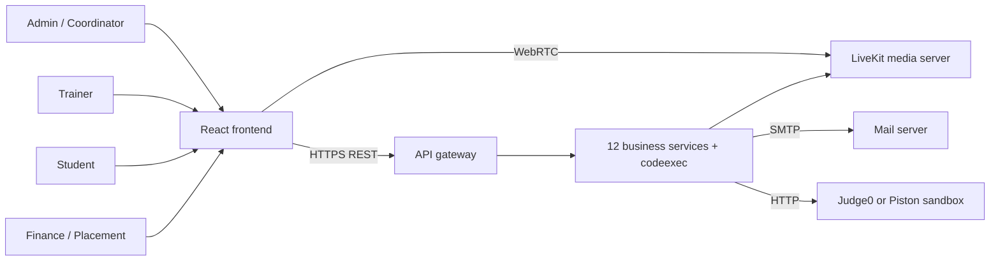

## 1.3 Container view

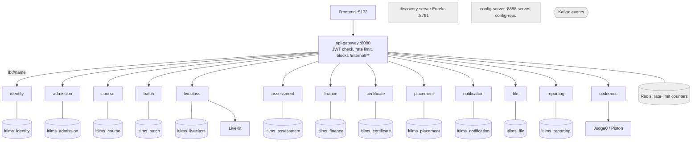

`codeexec` is stateless: no database, no Kafka.

## 1.4 Services and what each owns

| Service | Owns | Main roles that use it |
|---|---|---|
| identity | Accounts, passwords, tokens, sessions, branding | all |
| admission | Leads, follow-ups, student and trainer profiles, documents | ADMIN, COORDINATOR, PLACEMENT |
| course | Catalog, modules, lessons, lesson progress, practice-editor fields | ADMIN, COORDINATOR, TRAINER, STUDENT |
| batch | Batches, enrolments, timetable, attendance register | COORDINATOR, TRAINER, STUDENT |
| liveclass | Live rooms, join tokens, time in room, automatic attendance | TRAINER, STUDENT |
| assessment | Assignments, submissions, MCQ tests, attempts, results | TRAINER, STUDENT |
| finance | Fee plans, instalments, payments, receipts, overdue reminders | FINANCE, STUDENT |
| certificate | Completion check, issue, PDF, public verification | ADMIN, STUDENT, public |
| placement | Companies, jobs, eligibility, applications, interview pipeline | PLACEMENT, STUDENT |
| notification | In-app notifications, announcements, email outbox | all |
| file | Uploads, type and size rules, controlled download | all |
| reporting | Dashboards, exports, audit log | ADMIN |
| codeexec | Runs practice code in a sandbox | all signed-in |

Platform: **api-gateway**, **discovery-server**, **config-server**, and **common-lib** (shared security, errors, events, auditing, code generators).

## 1.5 Communication styles

| Style | Used when | Technology |
|---|---|---|
| Synchronous | The answer must be correct right now (is this student enrolled?) | Feign over HTTP, via Eureka |
| Asynchronous | Telling others a fact happened | Kafka events, published after commit |
| Media | Live video and audio | WebRTC, browser to LiveKit |
| Sandbox | Run student code | HTTP to Judge0 / Piston |

Rules: one writer per fact, events state facts not commands, failure behaviour chosen per call. Full call list and event list: [01-architecture.md](01-architecture.md).

## 1.6 Security architecture

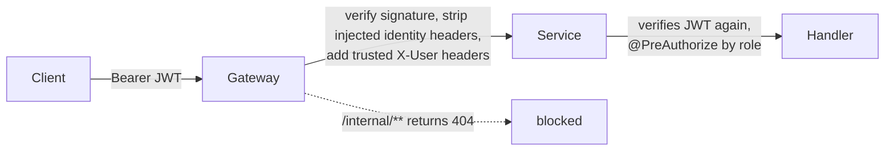

- Access token carries user id, role and the student/trainer profile id, so no service calls identity to learn who is calling.
- Refresh tokens are rotated. One active session per user (REPLACE or DENY policy): [12-single-active-login.md](12-single-active-login.md).
- Secrets come only from environment variables, with no default. A service refuses to start without them.
- Passwords and reset tokens are only emailed, never stored in a log or readable column.

## 1.7 Deployment view

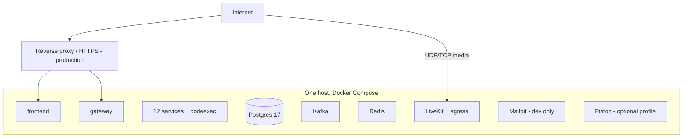

Local: Docker Compose, about 20 containers, at least 6 GB for Docker. Production additions (HTTPS proxy, real email, MinIO, backups): [07-deployment-guide.md](07-deployment-guide.md).

## 1.8 Trade-offs

- No foreign keys between services; the owner checks references before writing.
- Copied data (course titles, names) can lag by seconds.
- Dashboards are eventually consistent; a student's own data is read live from the owner.
- More containers to run than a monolith.

In return: independent deploys, one slow area cannot block another, scale where needed.

---

# Part 2: Low-level design (LLD)

## 2.1 Inside one service

Every service has the same layering (shown for liveclass-service):

```
com.itilms.<service>/
  controller/      REST endpoints, @PreAuthorize, no business logic
  dto/request, dto/response/   what crosses the wire, validated with Bean Validation
  service/ + service/impl/     business rules, transactions
  repository/      Spring Data JPA, Specifications for filtering
  entity/          JPA entities and enums (rules live on the enum, e.g. canMoveTo)
  client/          Feign clients to other services, each with its own fallback decision
  consumer/        Kafka listeners
  config/          properties, beans
  livekit/         (liveclass only) LiveKit adapter
resources/db/migration/   Flyway V1__..., one schema per service
```

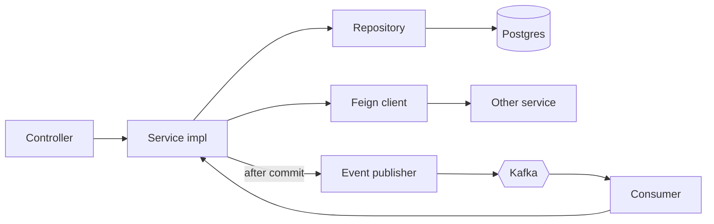

**common-lib** gives every service: JWT verification and `AppPrincipal`, the deny-by-default security chain, one error contract, the event publisher, auditing columns (`JpaAuditingConfig`), and code generators for student, batch and certificate numbers. It auto-configures when added as a dependency.

## 2.2 Error contract

One JSON error shape for every service. `BusinessRuleException` becomes a 4xx with a readable message (for example `Unknown role 'X'. Valid roles: ...`). Validation failures list the fields. Unauthenticated and forbidden are 401 and 403. The code editor adds 422 (bad language or too long), 429 (rate limit or busy), 503 (sandbox down).

## 2.3 Key flow: sign-in and single session

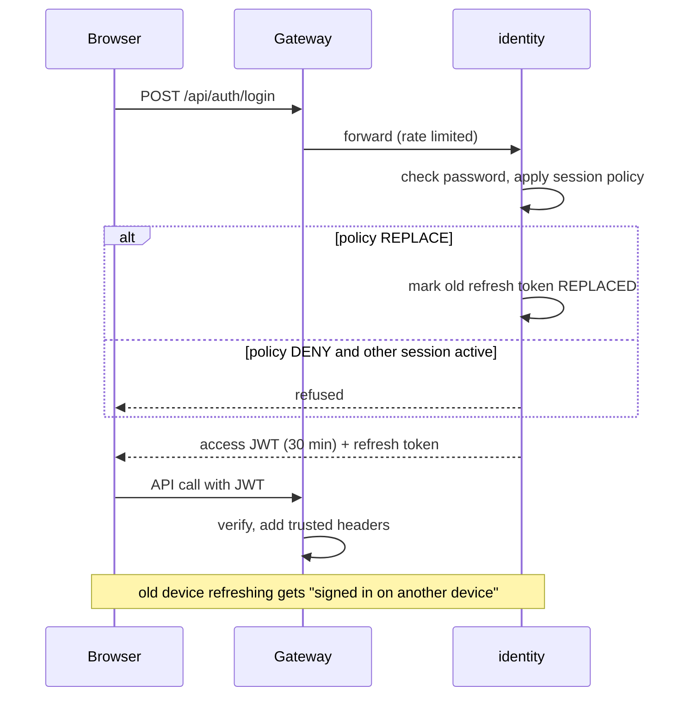

Detail: a refresh token row is the session; `session_id` survives rotation. An issued access token stays valid until it expires.

## 2.4 Key flow: admission to fee plan

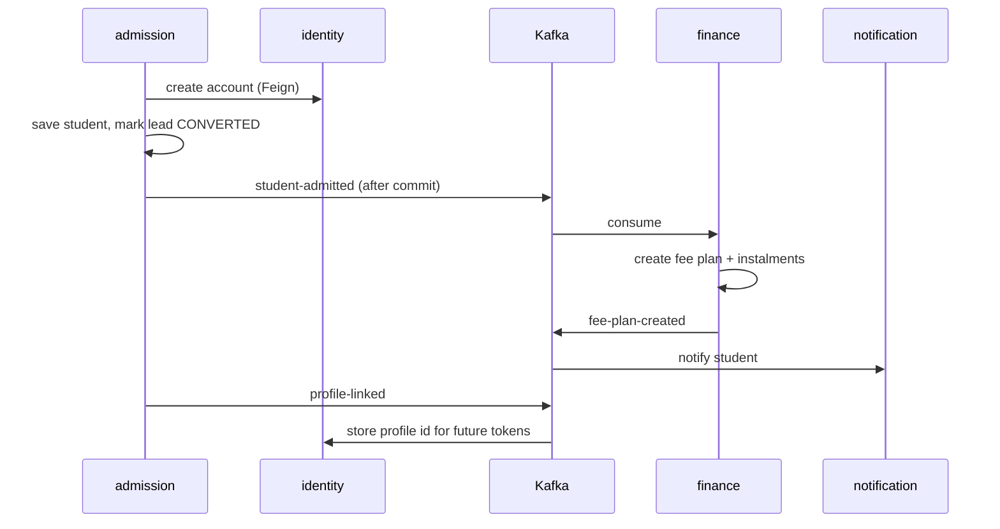

## 2.5 Key flow: live class and automatic attendance

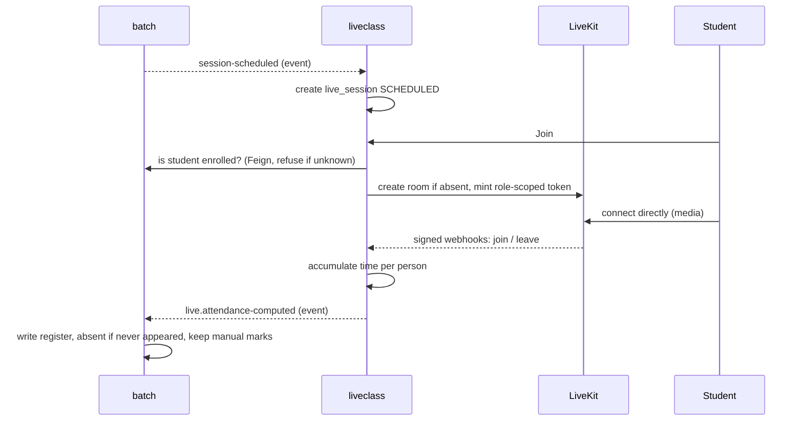

## 2.6 Key flow: practice code run

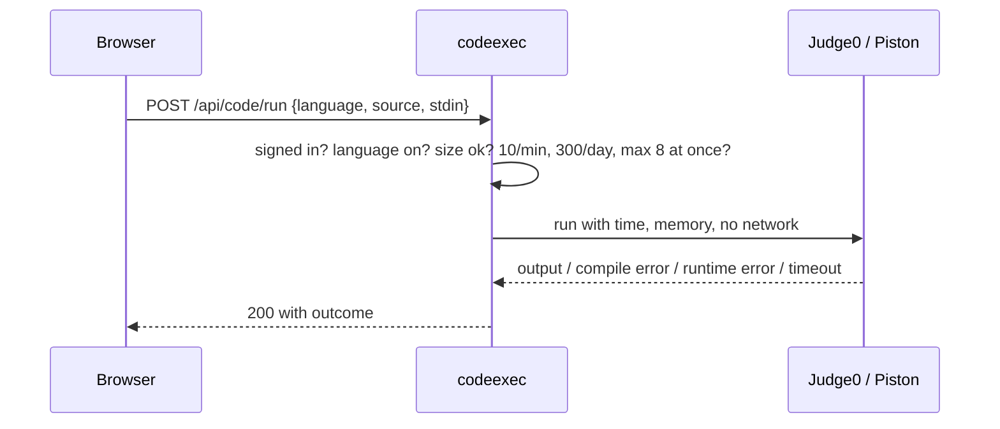

## 2.7 State machines

**Lead** (`LeadStatus`): NEW, CONTACTED, FOLLOW_UP, INTERESTED are open; NOT_INTERESTED, CONVERTED, LOST are closed.

**Batch** (`BatchStatus`): PLANNED → ONGOING → COMPLETED, or CANCELLED. Enrolment is accepted while PLANNED or ONGOING.

**Class session** (`SessionStatus`): SCHEDULED → COMPLETED, or CANCELLED / RESCHEDULED. Attendance is allowed while SCHEDULED or COMPLETED.

**Attendance** (`AttendanceStatus`): PRESENT, LATE count as present; EXCUSED is out of the denominator; ABSENT.

**Live session** (`LiveSessionStatus`):

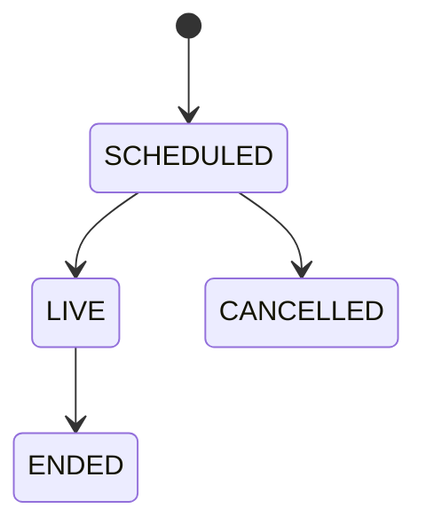

**Placement application** (`ApplicationStage`), rules enforced by `allowedNext()`:

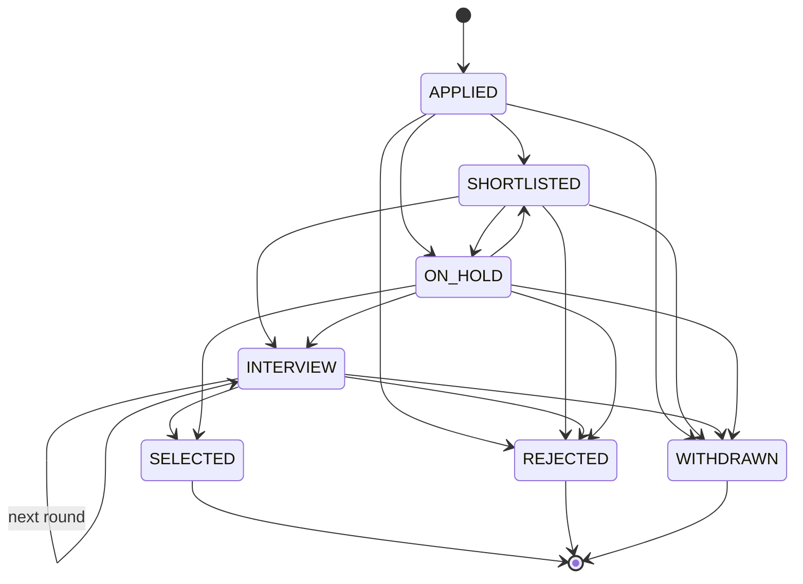

## 2.8 Data model (summary)

35 tables across 12 databases. Within one database real foreign keys are used; across services a column such as `course_id` is a plain `BIGINT` that the owner checks. Full table listing: [03-erd.md](03-erd.md).

Core relationships (logical, across services):

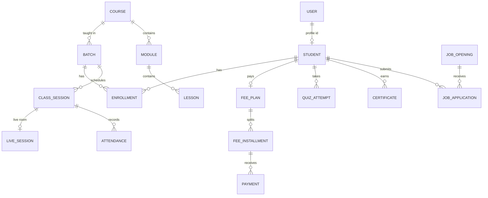

## 2.9 Events (LLD view)

- Topics are created at startup from `KafkaTopics`, three partitions each, keyed so one class or one student keeps its order.
- Publish only after the database transaction commits.
- Consumers are idempotent: an event may arrive twice.
- Email is written to `email_outbox` in the same transaction, then sent by a job, so a brief mail outage loses nothing.

Event list: [01-architecture.md](01-architecture.md#what-travels-over-kafka).

## 2.10 Cross-cutting pieces

| Concern | Design |
|---|---|
| Config | `config-repo/` served by config-server, secrets from env vars |
| Audit | Each service publishes `audit.recorded`; reporting stores one chronological log |
| Files | file-service validates type and size per category, checks access on download; storage is local disk, MinIO ready |
| Branding | Admin-set logo, name and sign-in background, held in identity (`InstituteSettings`): [13-branding.md](13-branding.md) |
| Certificates | A completion rule checked live against each owning service at issue time: [14-certificate-workflow.md](14-certificate-workflow.md) |
| Testing | Unit tests per module, route checker, 116-check smoke test: [06-test-plan.md](06-test-plan.md) |

## 2.11 Capacity (estimates, not measured)

On one 4 OCPU / 24 GB host: a few hundred concurrent normal users; about 30 to 50 viewers in one live class with student cameras off; about 10 to 15 simultaneous code runs before queuing (Piston `jobs=2`). Run a load test before promising numbers.

## 2.12 Extension: multi-institute

The design allows it but it is not built. It needs `institute_id` on every table, in the JWT, a gateway rule that resolves the institute from the subdomain, and an automatic query filter in common-lib, rolled out service by service. See the discussion in the project notes.
