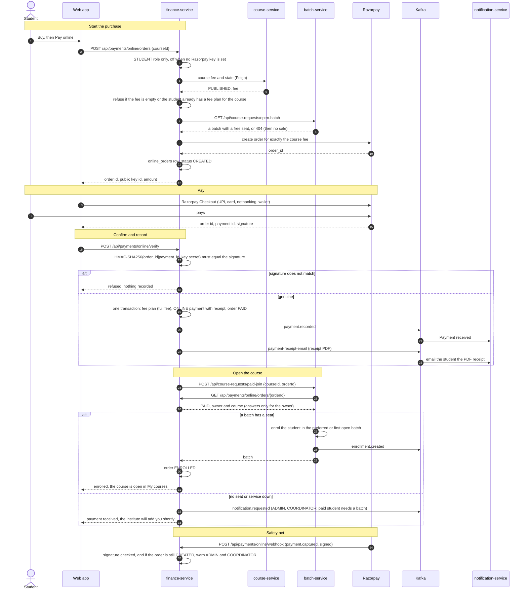
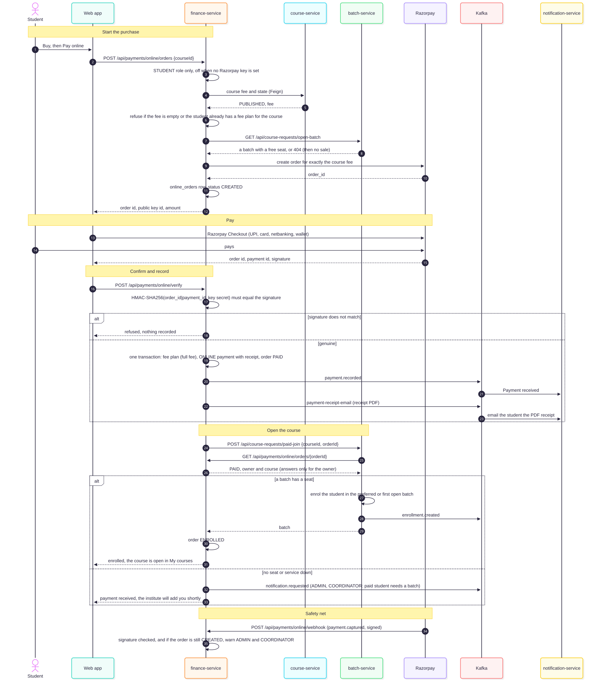

# Buying a course online (Razorpay)

A signed-in student can pay a course fee online. Once the payment is confirmed the fee and receipt are recorded and the student is placed in a batch, so the course opens at once. This is a departure from the PDF, which has staff record every payment ([02-documentation-review.md](02-documentation-review.md)).

## The flow

1. **Buy** on a course card (website or the student's Courses page) opens a choice: **Pay online** (only for a signed-in student, when Razorpay is set up and the course has a fee), continue to the course page (the existing request-to-join), or send an inquiry.
2. `POST /api/payments/online/orders {courseId}` (STUDENT). finance-service reads the fee and state from course-service, refuses unless a batch has a free seat (`GET /api/course-requests/open-batch` on batch-service) and the student has no fee plan for the course yet, creates a Razorpay order for exactly that fee and stores an `online_orders` row (CREATED). The amount comes from the server, never the browser.
3. The browser opens Razorpay Checkout (UPI, card, netbanking, wallet).
4. `POST /api/payments/online/verify` with the three values Razorpay returns. The server checks the signature `HMAC_SHA256(order_id|payment_id, key secret)` in constant time. If it is genuine, one transaction raises the fee plan (one installment, the full fee), records an `ONLINE` payment with the Razorpay payment id as its reference and receipt, and marks the order PAID.
5. finance-service then calls batch-service `POST /api/course-requests/paid-join`. batch-service asks finance-service whether that order is paid, belongs to the caller and is for that course, picks the batch (the preferred one, else the first with a free seat) and enrols the student. The order becomes ENROLLED.

If step 5 fails (no seat any more, service down) the order stays **PAID**, ADMIN and COORDINATOR get a notification, and the student sees "the institute will add you shortly". `POST /api/payments/online/orders/{id}/finish` retries it. The money is never left unrecorded.

## Diagram





The same diagram is kept as [diagrams/flows/43-online-course-payment.mmd](diagrams/flows/43-online-course-payment.mmd). Related: [fee payment](diagrams/flows/29-fee-payment.mmd) and the [finance schema](diagrams/db/finance.mmd), which now has `online_orders`.

## Receipt PDF by email

Every payment recorded in finance-service (online, or entered by staff as cash, UPI, cheque and so on) now emails the student a receipt, with a PDF attached. Nothing to switch on except mail itself (`MAIL_ENABLED`); the student needs an email address on their account.

- finance-service draws the PDF in `ReceiptPdfRenderer` (A4: header in the Branding colour with the logo, institute name and address; the student and course; the amount large with its words in lakh and crore; method and reference; total fee, paid so far and balance; contact line). Text uses the standard PDF fonts, so money is written `Rs.`, not with the rupee sign.
- The PDF travels in a `payment-receipt-email` event ([`PaymentReceiptEmailEvent`](../services/common-lib/src/main/java/com/itilms/common/event/PaymentReceiptEmailEvent.java)) because a Kafka consumer holds no sign-in and cannot ask finance-service for it later.
- notification-service queues it in `email_outbox` (migration V4 adds `attachment_name`, `attachment` and `event_id`). The usual retry applies; the attachment is dropped once the email is sent. A redelivered event is ignored through `event_id`.
- It never blocks the payment: if the branding service is down the receipt is drawn with a plain header, and if drawing or publishing fails the payment still stands and a warning is logged.
- A reversed payment sends no email. Its receipt can still be fetched, marked CANCELLED.

### Download in the portal

A student sees **PDF** beside each payment on **Fees** (and **Download PDF** in the receipt window); the finance desk has the same on a fee plan. It calls `GET /api/payments/{id}/receipt/pdf` (a student gets only their own, as with the JSON receipt) and returns the same document as the email, so the two never differ. The figures are as of the moment it is fetched, as on the screen receipt.

### What is on the PDF

- Header band in the Branding colour with the logo, the institute name and its full address.
- The institute logo as a faint watermark behind the page (the institute name set diagonally when there is no logo).
- Receipt number and date, student name and ID, the course, the amount large with its words, method and reference, total fee, paid so far and balance.
- At the foot: the institute name, address, phone and email (and website), all from the Branding page. Fill in address, phone and email there and they appear on every receipt.

## Paying fees you already owe (Fees page)

A student who already has a fee plan (from admission, or from an earlier purchase) pays what is left online from **Fees**:

- **Pay online** on the fee plan: the next installment, the whole balance, or any amount from 1 rupee up to what is owed. A small **Pay** beside an unpaid installment pays what is left of that installment.
- `POST /api/payments/online/fee-orders {feePlanId, amount?}` (STUDENT). The plan must be the caller's own and ACTIVE, and the amount cannot be more than the outstanding balance, so what Razorpay charges is always something the ledger accepts. Without an amount it is the whole balance. The order row has `kind = FEES` (migration V3) and the plan id from the start.
- The same `POST /api/payments/online/verify` checks the signature and records an `ONLINE` payment against the plan (receipt number, `PAYMENT_RECORDED`, the PDF receipt by email, exactly as for a payment staff enter). There is no batch step: the order ends as `FEES_PAID`.
- **A fee payment can never open a course.** `GET /api/payments/online/orders/{id}` reports a fee payment as `FEES_PAID`, never `PAID` or `ENROLLED`, and batch-service places a student only on a paid course purchase. Without that, paying a small installment of any plan could have been used to claim a seat.
- Two orders for the same balance at once: the second payment is refused by the ledger when it is recorded (it would exceed what is owed). The order stays unrecorded, ADMIN and COORDINATOR are told, and the money is refunded from the Razorpay dashboard.

## Webhook

`POST /api/payments/online/webhook` (public, listed in the gateway and in `FinanceBeans`) accepts Razorpay's `payment.captured` only with a valid `X-Razorpay-Signature`. Placing a student needs their sign-in, which a webhook does not have, so it only warns ADMIN and COORDINATOR when an order was paid but the browser never confirmed it (the student closed the tab). They then record the payment or place the student by hand.

## Setting it up

1. In the Razorpay dashboard use **Test mode** first. Copy the Key ID (`rzp_test_...`) and Key Secret.
2. Add a webhook: URL `https://<your-site>/api/payments/online/webhook`, event `payment.captured`, and a secret you choose.
3. On the server put these in `deploy/docker/.env` (never commit it), then recreate finance-service:

```
RAZORPAY_KEY_ID=rzp_test_xxxxxxxx
RAZORPAY_KEY_SECRET=...
RAZORPAY_WEBHOOK_SECRET=...
```

Empty key id or secret keeps online payment off: the **Pay online** button does not appear. Switch to live keys only after a full test payment.

## Rules

- One order per checkout; a payment is recorded exactly once (the order row is locked while it is recorded).
- A student who already has a fee plan for the course (for example from admission) cannot pay online for it; they pay installments from the Fees page.
- The fee plan, payment, receipt and the `PAYMENT_RECORDED` event are the same as for a payment staff record, so reports and reminders need no change.
- Refunds are not automated: staff refund in the Razorpay dashboard and reverse the payment under Payments.

## Tests

`RazorpaySignatureTest`, `OnlineCheckoutServiceTest` (finance-service) and the paid-join cases in `CourseRequestServiceTest` (batch-service). Nothing here has been run against Razorpay itself; do a Test-mode payment (Razorpay shows test card and UPI details) before going live.
