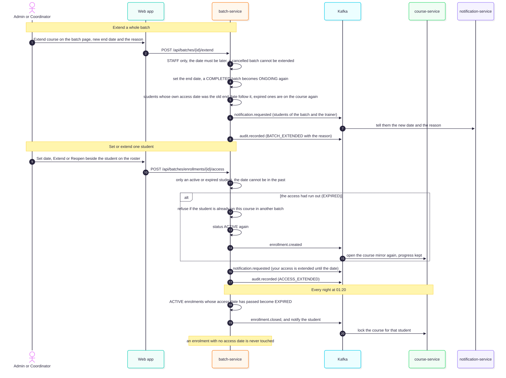

# Extending a course

Courses are often not finished by the planned end date. An administrator or coordinator can extend how long a course runs, for a whole batch or for one student. Built into batch-service.

## What the system did before

A batch has a start and an end date. After the end date a nightly job (`BatchStatusJob`) marks the batch COMPLETED, and it takes no new students. Nothing ever closed a student's access to the course, and a finished batch could not simply be started again.

## Extend a batch

**Extend course** on the batch page (ADMIN, COORDINATOR): a new end date and the reason.

- `POST /api/batches/{id}/extend {endDate, reason}`. The date must be later than the current end date (or the start date when there is none); a cancelled batch cannot be extended.
- A COMPLETED batch becomes ONGOING again.
- Students whose own access date was exactly the old end date move to the new one, and any of them whose access had run out are on the course again.
- The students of the batch and the trainer are notified with the new date and the reason; the change is audited as `BATCH_EXTENDED` with the reason.

## Set or extend one student

On the roster of the batch page each student has **Set date**, **Extend** or **Reopen**, and an **Access until** column (empty means "No limit").

- `POST /api/batches/enrollments/{id}/access {accessUntil, reason}`. Only a student who is on the course or whose access has run out; the date cannot be in the past. The student is notified; audited as `ACCESS_EXTENDED`.
- A student whose access had run out (EXPIRED) is on the course again: the enrolment becomes ACTIVE and an `enrollment-created` event is published, so course-service opens the course again with the progress kept. If the student is already on the same course in another batch the request is refused.

## The nightly expiry

`AccessExpiryJob` (01:20, `itilms.batch.access-sweep-cron`) closes ACTIVE enrolments whose **access date has passed**: status EXPIRED, an `enrollment-closed` event (course-service locks the course for that student) and a notification asking them to contact the institute.

**An enrolment with no access date is never touched.** Everyone enrolled before this feature has none, so nobody lost access when it went live. A date only exists when an administrator sets one. The roster page shows expired students too (`GET /api/batches/{id}/students?includeExpired=true`) so they can be reopened; the plain roster, and so the attendance register, still lists only active students.

## Data

Migration V3 of batch-service: `enrollments.access_until DATE` (empty = no limit), the status `EXPIRED`, and a partial index for the nightly query. Course-service treats an `enrollment-created` for an enrolment it already holds, when that mirror is closed, as "opened again".

## Not covered

- A new enrolment does not get an access date by itself, for example "the batch end date". If the institute wants every student's access to end with the batch, that is a small addition (set the date at enrolment); it was left out so that turning the feature on cannot lock anyone out by surprise.
- Extending does not change ID cards already issued (their "valid until" was fixed when printed) or fee plans.

Tests: `BatchValidityServiceTest` (batch-service), the reopening case in `ProgressServiceImplTest` (course-service), `extend-validity.test.tsx`.
