# Diagrams

Forty-one diagrams of IT-ILMS, each as Mermaid source (`.mmd`) and a rendered picture (`.svg`) beside it. GitHub and VS Code (Markdown preview) show the pictures below; the `.mmd` files are what you edit.

The short diagrams inside [../19-system-design-hld-lld.md](../19-system-design-hld-lld.md) are an overview. These go deeper: every service's real schema, every event, and each flow step by step.

| Group | Folder | Count |
|---|---|---|
| Architecture | [architecture/](architecture) | 6 |
| Database (ER, one per service) | [db/](db) | 12 |
| Flows (sequence) | [flows/](flows) | 13 |
| State machines | [states/](states) | 4 |
| Security | [security/](security) | 3 |
| Frontend | [frontend/](frontend) | 3 |

## Architecture

| # | Diagram | Shows |
|---|---|---|
| 01 | [System context](architecture/01-system-context.svg) | People, clients and external systems around IT-ILMS |
| 02 | [Containers](architecture/02-containers.svg) | Gateway, platform services, 13 business services, data stores |
| 03 | [Service calls](architecture/03-service-calls.svg) | Every synchronous (Feign) call between services |
| 04 | [Kafka events](architecture/04-kafka-events.svg) | Producer, topic and consumer for each event |
| 05 | [Deployment, Docker Compose](architecture/05-deployment-compose.svg) | Ports, internal-only containers, volumes |
| 06 | [Production server](architecture/06-production-server.svg) | HTTPS proxy, stack, backups, manual update path |



## Database

Generated from the Flyway migrations, replayed in order, so each diagram is the schema after the latest migration. Regenerate with `python deploy/scripts/generate-erd.py`, then render again (see below).

| # | Service | Diagram |
|---|---|---|
| 07 | identity | [db/identity.svg](db/identity.svg) |
| 08 | admission | [db/admission.svg](db/admission.svg) |
| 09 | course | [db/course.svg](db/course.svg) |
| 10 | batch | [db/batch.svg](db/batch.svg) |
| 11 | liveclass | [db/liveclass.svg](db/liveclass.svg) |
| 12 | assessment | [db/assessment.svg](db/assessment.svg) |
| 13 | finance | [db/finance.svg](db/finance.svg) |
| 14 | certificate | [db/certificate.svg](db/certificate.svg) |
| 15 | placement | [db/placement.svg](db/placement.svg) |
| 16 | notification | [db/notification.svg](db/notification.svg) |
| 17 | file | [db/file.svg](db/file.svg) |
| 18 | reporting | [db/reporting.svg](db/reporting.svg) |

Foreign keys are only drawn inside one database. Ids that point at another service (a student id in batch, a user id in notification) are plain columns on purpose: services never share tables.

## Flows

| # | Flow | Diagram |
|---|---|---|
| 19 | Sign-in, lock-out, single session, refresh rotation | [flows/19-sign-in-and-refresh.svg](flows/19-sign-in-and-refresh.svg) |
| 20 | Password reset, Google and WhatsApp sign-in | [flows/20-password-reset-and-social-login.svg](flows/20-password-reset-and-social-login.svg) |
| 21 | Lead to student to fee plan | [flows/21-admission-to-fee-plan.svg](flows/21-admission-to-fee-plan.svg) |
| 22 | Live class: join, room rules, attendance | [flows/22-live-class-join-and-attendance.svg](flows/22-live-class-join-and-attendance.svg) |
| 23 | Recording and transcript | [flows/23-recording-and-transcript.svg](flows/23-recording-and-transcript.svg) |
| 24 | A test attempt, start to result | [flows/24-test-attempt.svg](flows/24-test-attempt.svg) |
| 25 | Secure test monitoring | [flows/25-secure-test-monitoring.svg](flows/25-secure-test-monitoring.svg) |
| 26 | Running code and analysis | [flows/26-coding-run-and-analysis.svg](flows/26-coding-run-and-analysis.svg) |
| 27 | Certificate: request to public verification | [flows/27-certificate-request-to-verify.svg](flows/27-certificate-request-to-verify.svg) |
| 28 | Placement pipeline | [flows/28-placement-pipeline.svg](flows/28-placement-pipeline.svg) |
| 29 | Fee payment | [flows/29-fee-payment.svg](flows/29-fee-payment.svg) |
| 30 | Notifications and the email outbox | [flows/30-notification-and-email-outbox.svg](flows/30-notification-and-email-outbox.svg) |
| 41 | ID cards: issue, photo, print, own card, QR check, withdraw | [flows/41-id-card-issue-print-verify.svg](flows/41-id-card-issue-print-verify.svg) |

## State machines

| # | Diagram |
|---|---|
| 31 | [Quiz and attempt](states/31-quiz-and-attempt.svg) |
| 32 | [Live session](states/32-live-session.svg) |
| 33 | [Placement application](states/33-placement-application.svg) |
| 34 | [Lead, enrollment, certificate request, course request](states/34-lead-enrollment-and-certificate-request.svg) |

## Security

| # | Diagram |
|---|---|
| 35 | [Roles and the areas they reach](security/35-roles-and-access.svg) |
| 36 | [How a request is authenticated and authorized](security/36-request-authentication-path.svg) |
| 37 | [Test integrity layers](security/37-test-integrity-layers.svg) |

Written up in [../26-security.md](../26-security.md).

## Frontend

| # | Diagram |
|---|---|
| 38 | [Routes and guards](frontend/38-routes-and-guards.svg) |
| 39 | [Data and token flow](frontend/39-data-and-auth-flow.svg) |
| 40 | [Pages, API modules and services](frontend/40-pages-api-services.svg) |

## Editing and rendering

Edit the `.mmd`, then render. With Node installed:

```bash
npx -p @mermaid-js/mermaid-cli mmdc -i docs/diagrams/flows/24-test-attempt.mmd -o docs/diagrams/flows/24-test-attempt.svg -b white
```

(mermaid-cli needs a Chrome or Chromium; point it at an installed one with `-p puppeteer.json` containing `{"executablePath": "<path to chrome>"}`.) Paste a `.mmd` into https://mermaid.live to preview without installing anything.

Accuracy: the schema diagrams and the call and event graphs were taken from the code. The flow diagrams follow the code paths and docs, but they simplify; when a flow and the code disagree, the code is right, so fix the diagram.

## Not for the server

This folder is documentation only. It is not part of any Docker image and is not copied to the running server by the manual update steps in [../07-deployment-guide.md](../07-deployment-guide.md).
